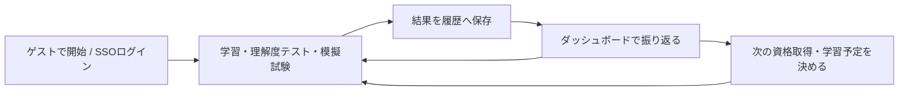
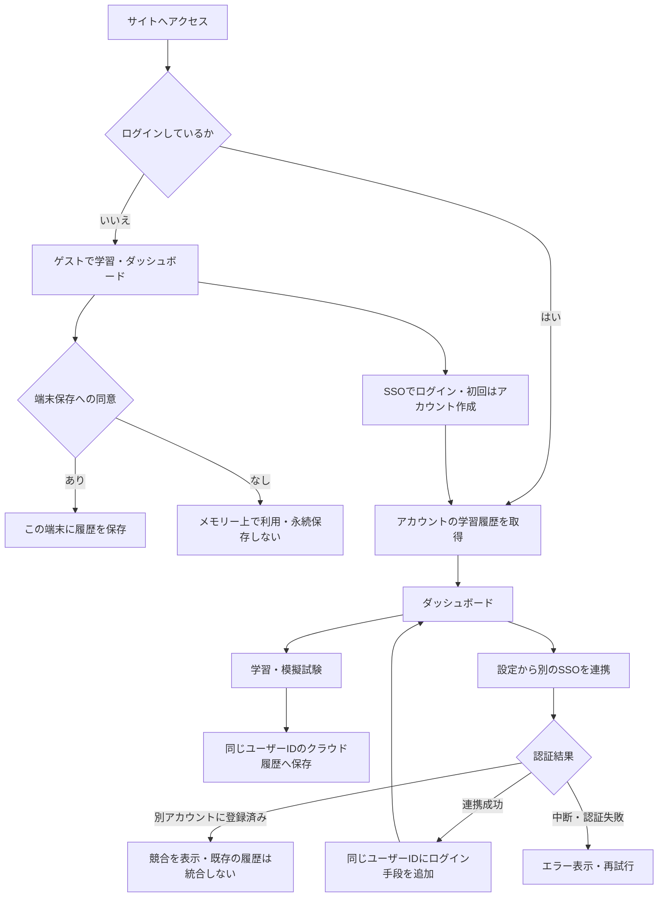
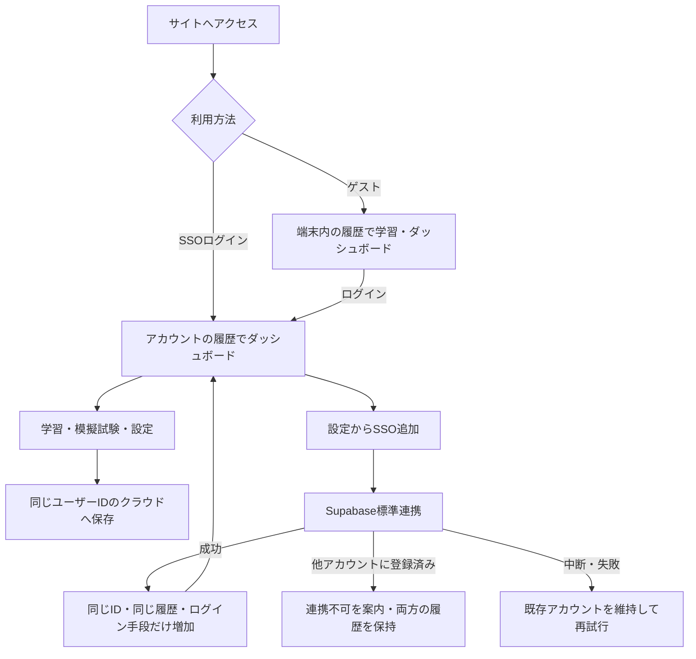

# アカウント・学習履歴の As-Is / To-Be

## 全体の利用目的と到達点

利用者の流れは「学習する→結果を保存する→ダッシュボードで振り返る→次の学習・資格取得の予定へ進む」。認証は履歴を端末間で使うための入口であり、学習の必須条件にはしない。

最後の予定管理はIssue60の未実装部分。ログイン直後のホームはダッシュボードとし、ゲストは学習画面からもダッシュボードを利用できる。

| 境界 | As-Is（公開済み） | To-Beと今回の差分 |
| --- | --- | --- |
| 学習・振り返り | ゲスト・会員とも学習とダッシュボードを利用 | 既存機能を維持する |
| 履歴の正本 | 同意済みゲストは端末内、会員は本人のクラウド | 保存先を増やさない。ログイン時は会員履歴へ切替 |
| SSO | GitHub・Google・Microsoftの通常ログインと標準連携 | 同じIDへのログイン手段追加を維持。別IDの履歴統合は劣後 |
| 個人設定 | 取得資格はクラウド、言語・テーマは端末中心 | Issue59で言語・テーマをアカウントに保存。既存の取得資格編集を再利用 |
| 次の行動 | 学習実績を見て、次の学習へ進む | Issue60で学習・模試・本番試験の予定を保存し、実績とは区別してダッシュボードへ表示 |
| 外部サービス追加 | Facebookは未完了 | 設定・予定管理の後に対応。Amazonは対象外 |

この表のTo-Beは未実装分を含む到達点であり、公開済みという意味ではない。以降に、保存・認証の境界と例外時の扱いを示す。

## 判断の前提

2026-11-22 のユーザー指示に基づく整理。まず全体フローを固定し、その差分だけを実装・整理する。既存の標準連携の成功はユーザーから確認済み。今回それを新機能として作り直さない。

As-Is は現在のソースと利用者からの報告に基づく。本番の設定・適用済み migration の最新状態まで再確認した文書ではない。下記の「追加中」は本番の利用者フローに接続済みという意味ではない。

追記: 2026-11-22 11:12 UTC に本番を読取り専用で確認。適用済み migration は `202611220001_learning_owner_shadow` までの15件で、公開 Edge Function は `delete-account` のみ。後続の context/session-grants/account-creation の3件は未適用。証跡は `test-results/design-audit/production-retirement-preflight.json`。これらの既適用15件と公開退会機能は保護し、未適用の独自統合用3件は整理対象にできる。

## As-Is：現在の利用者フロー

- ログインと連携は別操作。連携はログイン中に設定画面から始める。
- 標準連携ではユーザーIDは変わらず、連携済みのどのSSOから入っても同じ履歴を参照する。
- ゲストの端末履歴と会員のクラウド履歴は別。既存の端末データの明示的な移行導線はあるが、ログインしただけで自動統合するものではない。
- 会員の正本はクラウド。端末の一時再送キューは別の履歴の正本ではなく、通信失敗への対処。
- SSOサービス側の認証・標準のidentity linkingと、KAQによる別ユーザーID間の履歴統合を区別する。Supabase標準のメールに基づくidentity linkingの挙動もあるため、「別SSOで入ると必ず別アカウントになる」とは断定しない。

根拠：`src/auth/SupabaseAuth.ts`、`src/auth/AccountSettings.tsx`、`src/auth/AuthCallback.tsx`、`src/progress/store.ts`、`src/progress/ProgressCoordinator.ts`、`docs/data-persistence.md`。

## As-Is：開発側で増やしてしまった別フロー

別ユーザーIDのアカウント同士をまとめるため、本人確認の独自管理、統合前確認、履歴の突合、所有者の切替、古い認証状態への対策などを追加していた。標準連携とは異なる問題を同時に解こうとしていたことが複雑化の原因。

これらの試作・専用テストの存在は、本番でアカウント統合が動いている証拠ではない。既存の標準連携に必要な部品でもない。

## To-Be：今回残す全体フロー

### 変えること・変えないこと

| 項目 | 今回の扱い |
| --- | --- |
| SSOログイン、ログイン後のダッシュボード | 維持 |
| 設定からの標準SSO連携 | 維持。既に通る成功ケースを中心にする |
| 学習データの所有者 | 既存のSupabaseユーザーIDを維持 |
| ゲスト利用・同意済み端末保存 | 維持 |
| ゲストからログインした後 | 会員履歴へ切替。ゲスト履歴の自動合算は追加しない |
| 既存の明示的な端末履歴移行 | 今回のSSO整理とは切り離す。削除・変更を暗黙に行わない |
| 別ユーザーID同士の統合・履歴の合算 | 劣後。氏名やメールを根拠にKAQ側で自動統合しない |
| 新たなCookie引継ぎ・統合時のゲスト履歴移送 | 劣後 |
| 独自の本人確認・統合・所有者切替の試作群 | 今回のフローに接続しない。参照関係と適用状態を確認して整理 |
| 適用済みDB構造・既存の実データ | この整理を理由に削除しない |
| Amazon / Facebook | Amazonはスコープ外。Facebookは後続 |

### セッションとデータのライフサイクル

| 操作 | To-Beで使うデータと終了状態 |
| --- | --- |
| ログイン | 認証されたIDのクラウド履歴へ切替。元のゲスト履歴を自動投入しない |
| 同じアカウントに連携した別SSOでログイン | 同じIDの同じ履歴を読む。履歴のコピー・移送はない |
| 別アカウントへ切替 | 前のIDの表示・保留書込みを次のIDへ持ち込まない。新しいIDの履歴を読む |
| ログアウト | 会員の履歴表示を終了し、ゲスト利用へ戻る。クラウド履歴は削除しない |
| SSO解除 | 設定から解除する。最後のログイン手段は解除できない。履歴の所有者は変わらない |
| 学習リセット | 本人の学習データだけを既存契約で初期化。古い再送による履歴復活を拒否する |
| 退会 | 本人のアカウントと紐づくクラウドデータを既存の退会処理で削除する。他人やゲスト原本を巻き込まない |
| 通信失敗 | 未保存・未同期を表示。同じ本人の再送として扱い、成功や履歴0件と偽らない |

これらは既存の認証・保存境界を維持する条件であり、統合専用の状態管理を追加する理由にはしない。

### 残Issueの位置付け

通常の学習・模試の結果は既存の履歴へ保存し、ダッシュボードが同じ正本から集計する。#59はこのアカウントに言語・テーマ・取得資格の設定を揃える。#60は同じ所有者に資格取得目標と学習・模試・本番試験の予定を保存し、ダッシュボードへ表示する。予定と実績は区別する。いずれも別アカウント統合の完成を前提にせず、新しい所有者モデルを作らない。

## 差分と実施順序

1. このフローを起点に、旧計画の独自統合・新規引継ぎの要件を劣後として整理する。
2. 通常ログイン・標準連携・学習保存から未参照の試作と専用処理を特定する。削除対象を確定する前に実装を増やさない。
3. 対象を分離して整理し、既存の認証・学習・ダッシュボードの検査で退行がないことを確認する。実データの統合・削除は行わない。
4. ダッシュボードの後続である設定拡充・マイルストーンへ進み、Facebookはその後に扱う。

## 対応台帳

- [/] 全体フローのAs-Is / To-Beを先に明文化する。
- [x] 旧計画・Issueの範囲をこのフローに合わせ、劣後と今回の完了を区別する。
- [x] 不要な試作の参照・適用状況を確認し、安全に整理する。
- [x] 既存機能の検査・レビュー・公開まで完了する。

2026-11-22: [PR #111](https://github.com/HiroyukiFuruno/katana-aws-qualification/pull/111) を通常mergeし、[本番](https://kaq.katana-projects.org) のreleaseCommit `873c6b49463436a5987f81b09f2c78cbe837b554` とREADYを確認。独自試作318ファイルを整理し、全check789件・認証166件・画面178件・実DB/PG17/18が成功。広告修正の並行合流後も全checkと関連40件が成功した。公開390pxの3 provider/画像/有効状態/横はみ出しをDOMで検査した。別Auth userの履歴統合は劣後のままである。

2026-11-22 #59公開後の更新: アカウントの言語・テーマ設定と既存取得資格の導線を公開した（PR113、merge1b533761）。上のAs-Is表は実装前の比較であり、現在の会員設定はクラウドを正本とする。次は#60の取得目標・学習予定で、Facebookはその後。
